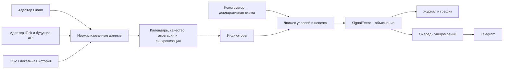

# TradeMaster — техническое задание на desktop-приложение

> Актуальное упрощение конструктора: [CURRENT_SIGNALS.md](CURRENT_SIGNALS.md). Пять индикаторов, группы И / ИЛИ, без временных окон и цепочек; две начальные схемы вверх / вниз. Прежние описания этих возможностей ниже относятся к предыдущему объёму.

Версия: 0.1. Дата: 4 ноября 2026 года. Статус: проект для обсуждения, разработка приложения ещё не начата.

## 1. Назначение и принятые требования

TradeMaster подключается к поставщику рыночных данных, наблюдает за выбранными инструментами, вычисляет индикаторы и отправляет пользователю уведомления при выполнении созданных им схем условий.

Подтверждено пользователем:

- Desktop для macOS и Windows; macOS — основная платформа.
- Пользователь вводит ключ доступа к API; первый источник — [Finam Trade API](https://api.finam.ru/tokens/).
- Впоследствии можно добавлять других поставщиков.
- **iTick включён в план как второй источник:** REST для каталога/свечей и WebSocket для live-данных, через тот же DataProvider. Подробности и ограничения: [ITICK.md](ITICK.md).
- Пользователь выбирает инструменты и самостоятельно собирает сигналы из условий.
- Условия объединяются операторами **И / ИЛИ** с вложенными группами; одна схема образует один сигнал.
- Показатели, таймфреймы и инструменты доступны как редактируемые таблицы-справочники. Инструменты можно добавлять вручную.
- **Один сигнал объединяет условия с разных таймфреймов**, в том числе по схеме И.
- Telegram используется для оповещений.
- Основная сущность интерфейса — **валютная пара и её сигналы**: график, создание сигналов и просмотр событий организованы внутри выбранной пары.
- Предоставленный скриншот Bybit — приблизительный ориентир по визуальному стилю, без копирования продуктовой логики и точного воспроизведения оформления.
- Всё критичное для правильной работы сигналов покрывается автоматическими регрессионными тестами: каждый элемент и каждая эталонная схема отдельно, а также полный процесс и совместная работа сигналов.
- Схема из исходного README — пример, который должен воспроизводиться конструктором, а не единственный встроенный алгоритм.
- Продукт — универсальный конструктор и среда проверки вариаций. Решения «запоминать/перепроверять», состав подтверждений, окна, пороги и объёмные фильтры задаются в конкретной схеме, а не выбираются один раз для приложения. Выбор одного паттерна из README не является условием начала разработки.

Предлагаемые границы первой версии, которые можно изменить при обсуждении: один локальный пользователь, подключения Finam и iTick, один Telegram-бот и один личный чат. Для пары/назначения выбран один источник; разные пары могут работать с разными подключениями. Один экземпляр сигнала относится к одному инструменту и может использовать несколько таймфреймов одного источника. Схему можно назначать нескольким инструментам независимо; сравнение разных инструментов/источников внутри одной схемы отнесено к последующему расширению.

Выставление ордеров, управление позициями и автоматическая торговля не входят в текущий объём. Приложение использует данные для анализа. Биржевые операции не добавляются только из-за наличия API-ключа.

## 2. Основные сущности

| Сущность | Содержимое |
|---|---|
| Подключение | Поставщик, название, ссылка на секрет, права и состояние сессии |
| Пара | Пользовательская рабочая область с сигналами; её ID не совпадает с внешним кодом поставщика |
| Привязка инструмента | Пара + подключение + проверенный внешний инструмент; у пары несколько привязок, одна активная |
| Набор данных | datasetId и свойства происхождения/цены/объёма/окружения/календаря/агрегации; ключ для баров и кешей |
| Инструмент | Внутренний ID, provider ID, площадка, тикер, название, класс, валюта, шаг цены, единица объёма, расписание |
| Индикатор | Тип, источник данных, параметры, именованные выходы |
| Таймфрейм | ID, длительность/календарный период, подпись, native/derived, источник построения, привязка границ |
| Условие | Левая и правая части, оператор, смещение/окно, подпись |
| Группа | Оператор И / ИЛИ и дочерние условия или группы |
| Схема сигнала | ID, версия, индикаторы, группы, режим времени, правила повторения, настройки сообщения |
| Назначение | Схема + подключение + инструмент + настройки таймфреймов условий + enabled; отдельное состояние выполнения |
| Событие | Назначение, версия схемы, время свечи, результат и объяснение условий |
| Доставка | Событие, канал, статус, попытки, следующая попытка, результат Telegram |

Цена и объём в хранении и IPC передаются десятичными строками. Метки времени — UTC; интерфейс показывает выбранный часовой пояс, по умолчанию системный.

## 3. Пользовательские сценарии

### 3.1 Первый запуск

1. Выбрать Finam или iTick, ввести ключ соответствующего API, нажать «Проверить подключение».
2. Получить статус авторизации, доступность рыночных данных и известную задержку котировок.
3. Найти доступные инструменты через справочник поставщика и добавить их в список наблюдения.
4. Подключить Telegram, выполнить тестовую отправку.
5. Создать схему с нуля либо скопировать шаблон, выбрать инструменты и таймфрейм каждого условия.
6. Проверить схему на доступной истории и включить мониторинг. Результат проверки сохраняется; прибыльность не является условием включения.

Если Telegram ещё не подключён, мониторинг и локальный журнал доступны; состояние доставки видно явно.

### 3.2 Создание схемы

Пользователь задаёт название, выбирает индикаторы, создаёт корневую группу И / ИЛИ, добавляет условия и вложенные группы, настраивает повторения и сообщение. Изменения сохраняются в черновик. Включение валидной версии создаёт неизменяемую исполняемую ревизию.

Из сигнала пары доступно «Создать вариант»: независимая копия с собственным ID, названием и конфигурацией. Пользователь меняет любые поддерживаемые параметры, добавляет/удаляет условия и группы, переключает И / ИЛИ и проверяет несколько выбранных вариантов на одном наборе данных. Исходный сигнал и его работающая ревизия при этом не меняются. Несколько вариантов можно наблюдать параллельно с раздельными событиями и явно выбранными каналами уведомлений.

Пример другой схемы, собираемой без кода:

```text
Сигнал «Восстановление импульса», на закрытии свечи
И
├─ EMA(close, 5) пересекает EMA(close, 10) вверх
├─ ИЛИ
│  ├─ Stochastic(10, 5, 5).K < 30
│  └─ И
│     ├─ MACD(WMA 6, WMA 8, signal WMA 4).hist растёт 2 свечи
│     └─ volume > SMA(volume, 9) × 1.2
└─ EMA(close, 30) > EMA(close, 30) 3 свечи назад
```

«Сигнал» здесь означает совпадение пользовательских условий; одно событие содержит результат всей схемы, а не отдельное уведомление на каждую ветку.

### 3.3 Работа с событием

Уведомление появляется в журнале и очереди Telegram. В карточке видны инструмент, время оценки, все использованные таймфреймы, цена, версия схемы и результаты всех проверенных веток. Для каждого условия сохраняется время конкретной использованной свечи. Выбор события открывает график на соответствующей свече с переключением между участвовавшими таймфреймами.

## 4. Экраны

| Экран | Обязательные функции |
|---|---|
| Главная — Пары | Список моих пар; рабочая область выбранной пары: график, её сигналы и события; состояние подключения |
| Инструменты | Поиск, фильтр по площадке/классу, список наблюдения, таймфреймы, доступность данных |
| Справочники | Таблицы показателей, таймфреймов и инструментов; создание, изменение, копирование, архивирование строк |
| Сигналы пары и шаблоны | Создание/копирование внутри пары, версии, включение/выключение, импорт/экспорт; общие схемы доступны как шаблоны |
| Редактор схемы | Вложенные карточки И / ИЛИ, индикаторы, условия, временные этапы, проверка ошибок, текстовое представление |
| График | Свечи, EMA, объём, панели стохастика/MACD, маркеры событий и значения под курсором |
| Журнал | Фильтры по периоду, инструменту, схеме и доставке; подробное объяснение; экспорт CSV/JSON |
| История | Период, качество данных, replay/бэктест выбранной версии, отчёт и экспорт |
| Настройки | Подключения Finam/iTick, Telegram, хранение, фон, часовой пояс, диагностика |

Первый интерфейс — на русском, с тёмной темой. Скриншот Bybit задаёт приблизительное визуальное направление: графитовые панели, светлый текст, янтарный акцент и зелёные/красные свечи. Точные цвета/шрифты и продуктовая логика Bybit не копируются. На главной: пары слева, график выбранной пары в центре, её сигналы справа, её события снизу. Ключи API и глобальные параметры вынесены в настройки. Подробности: [UI.md](UI.md).

Для живого графика выбранной пары в первый релиз включаются REST-загрузка истории и WebSocket BARS для обновления текущей свечи. Визуализация использует незакрытые обновления, сигналы — только подтверждённые закрытые бары. Переключение периода графика не меняет таймфреймы условий. Один шаблон, применённый к двум парам, создаёт независимые сигналы; общие шаблоны не подменяют структуру «пара → её сигналы».

Редактор строится как дерево групп с понятными отступами и кнопками «Добавить условие / группу», без обязательного рисования связей на полотне.

Компонентная основа: Ant Design для экранов, таблиц, форм и изменяемых панелей; React Query Builder с Ant Design-интеграцией для вложенных И / ИЛИ; KLineCharts для свечного графика. Предпочтение отдаётся коробочным решениям, размер приложения вторичен. Собственный код сосредоточен на данных, моделях сигналов, синхронизации и уведомлениях. Подробности выбора: [STACK.md](STACK.md).

## 5. Конструктор условий

### 5.1 Индикаторы первой версии

В таблице показателей строка — именованная конфигурация: например, «MACD быстрый» с параметрами WMA 6/8/4, «Стохастик основной» 10/5/5, «Пересечение EMA 5/10 вверх». Пересечение является производным условием над двумя EMA, но доступно пользователю как готовый блок. Колонки: название, тип, параметры, входной ряд, выходы/операция, состояние. Выбор таймфрейма задаётся при использовании блока в схеме; одна конфигурация переиспользуется на разных периодах.

Таблица таймфреймов содержит, например, 5, 10, 15, 30, 60 минут и 1 день. Она объединяет периоды поставщика и периоды, которые приложение способно корректно построить. Колонки: название, длительность, источник, статус поддержки, базовый период и правило границ для вычисляемого таймфрейма.

Таблица инструментов позволяет вручную добавить отображаемое имя («Евро / доллар»), код поставщика и площадку, затем проверить их через API. Имя EUR/USD не означает автоматическую доступность такого инструмента у Finam: подписка включается после сопоставления с реальным инструментом и проверки прав. Не найденная строка остаётся в справочнике с объяснением и не запускает мониторинг.

Схема ссылается на версии конфигураций либо сохраняет их снимки. Изменение строки справочника не меняет молча уже работающие сигналы. Удаление используемых строк заменяется архивированием или требует явного переназначения ссылок.

- OHLCV: open, high, low, close, volume; числовые константы.
- SMA, EMA, WMA: период и входной ряд настраиваются.
- Stochastic: длина K, сглаживание K, сглаживание D; выходы K и D.
- MACD: fast/slow/signal, типы средних отдельно; выходы line, signal, hist.
- Средний объём и отношение объёмов заданных участков, локальные минимум/максимум.
- Подтверждённые фракталы с параметром числа свечей по сторонам; доступность только после правых свечей.

Исходные настройки EMA 5/10/30/90, Stochastic 10/5/5, MACD 6/8/4 на WMA и Volume SMA 9 поставляются шаблоном. Параметры редактируются; значения 80/20, 0.8/1.2 и окна не зашиваются в алгоритм.

Добавление **схемы из существующих блоков** не требует программирования. Новый тип индикатора или принципиально новый оператор добавляется разработчиком в реестр блоков с параметрами, расчётом, описанием и проверками. Исполнение произвольного пользовательского кода в первой версии не требуется.

### 5.2 Доступные операции

| Операция | Определение |
|---|---|
| Сравнение | >, >=, <, <=; равенство с явной абсолютной погрешностью, по умолчанию 0 |
| Пересечение вверх | A[i−1] <= B[i−1] и A[i] > B[i] |
| Пересечение вниз | A[i−1] >= B[i−1] и A[i] < B[i] |
| Изменение | Текущее значение относительно значения N свечей назад; разность или процент |
| Рост/снижение N свечей | Все N последовательных сравнений в выбранном направлении; отдельно задаётся строгость |
| Диапазон | Значение внутри/вне границ с явным включением границ |
| Окно | Условие истинно хотя бы на одной либо на всех свечах последних N закрытых баров |
| Арифметика | × / + − в типизированных выражениях; деление на ноль даёт «нет данных» |
| Группа И / ИЛИ | Вложенные группы, не менее одного дочернего элемента |

Обе части сравнения могут ссылаться на индикатор, OHLCV, константу или выражение. Ссылка на ряд содержит таймфрейм. Доступны смещения только в прошлое; N свечей отсчитывается в таймфрейме соответствующего ряда. Будущие смещения запрещены. Числовые сравнения допускают разные таймфреймы сторон. Для пересечения два ряда в первой версии должны иметь одинаковый таймфрейм; сами условия пересечений разных периодов свободно объединяются группами И / ИЛИ.

Для первой версии предлагаются ограничения защиты интерфейса: глубина групп до 8, до 100 условий в схеме, окно до 10 000 баров. Превышение показывает ошибку, а не обрезает схему.

### 5.3 Результаты и отсутствие данных

Каждый узел возвращает `true`, `false` либо `unknown` с причиной. Недостаточный прогрев, недопустимое деление и повреждённые данные не превращаются в ноль.

- И: `false`, если хотя бы один ребёнок false; `true`, если все true; иначе unknown.
- ИЛИ: `true`, если хотя бы один ребёнок true; `false`, если все false; иначе unknown.
- Событие возможно только при результате true. Жёсткая ошибка качества входного потока блокирует всё назначение до восстановления.
- Объяснение сохраняет дерево результатов, значения и время входных данных. Unknown не отображается как «условие не выполнено».

### 5.4 Два режима схемы

**На закрытии свечи.** Всё дерево вычисляется на единый момент оценки с использованием доступных к нему закрытых свечей каждого таймфрейма. По умолчанию событие создаётся при переходе результата из false в true. В текущей реализации включение сначала прогревает данные и запоминает текущее состояние без исторического события; затем требуется новый переход false → true. Unknown не перевзводит правило. Дополнительный целевой режим — повтор каждые N подходящих закрытий опорного таймфрейма с настраиваемым cooldown; он ещё не реализован.

**Цепочка во времени.** Пользователь задаёт триггер, группы подтверждений, срок ожидания, сброс и итоговые условия. Это необходимо для схемы README: обычное И на одной свече не выражает подтверждения в разные моменты времени.

Runtime-версия поддерживает общее окно от триггера, параллельные/последовательные группы и политики фиксации, сброс, итоговый фильтр, окна поиска до триггера и итоговые метки. Индивидуальные сроки относительно предыдущих этапов и checkpoint остаются целевыми требованиями. Точная текущая семантика: [IMPLEMENTATION_STATUS.md](IMPLEMENTATION_STATUS.md#текущая-семантика-цепочек).

- Триггер и каждое подтверждение — такие же деревья И / ИЛИ.
- Подтверждения выполняются параллельно либо в заданной последовательности этапов.
- Смещения окон задаются относительно триггера или предыдущего этапа; для поиска до триггера доступны только уже закрытые свечи.
- Для параллельных подтверждений выбирается «все группы» или «хотя бы одна группа».
- Для каждой группы явно выбирается фиксация факта: «запомнить выполнение» либо «должно оставаться истинным при завершении».
- У окна явно указан таймфрейм отсчёта. Включительная граница «3 свечи после триггера» означает t0, t0+1, t0+2, t0+3 в опорном периоде; сброс по таймауту — после проверки t0+3. Данные остальных периодов подбираются по правилу раздела 6.
- Сброс имеет приоритет над завершением на одной свече. Новый триггер заменяет активную цепочку того же назначения, если выбран режим замены; по умолчанию активна одна цепочка.
- После события цепочка закрывается. Дополнительный cooldown настраивается независимо; для шаблона README по умолчанию 0, повтор ограничен новым кроссом.
- Итоговые ветки могут присваивать метку «ранний» / «подтверждён» одному событию. Порядок веток задан явно; есть ветка по умолчанию.

Последовательные этапы по умолчанию могут завершиться на одной свече; опция «не ранее следующей свечи» меняет это поведение явно.

Это параметры общего конструктора, а не фиксированные свойства стохастика/MACD. Одна схема может запоминать факт одного подтверждения и перепроверять другое; другая — не иметь триггера или временной цепочки и проверять только дерево условий. Фильтр объёма, итоговые метки и предшествующее движение подключаются по необходимости. Границы объёмных участков задаются параметрами блока: привязка к триггеру/этапу/экстремуму, окно, направление экстремума и включение крайних баров. Неподдерживаемая комбинация показывает ошибку, а не заменяется правилом шаблона README.

### 5.5 Версии и переносимость

Схема хранится как декларативный JSON-документ: `schemaVersion`, `id`, `revision`, индикаторы, дерево выражений, временные этапы, сброс, повторы и шаблон сообщения. Положение карточек и состояние раскрытия хранятся отдельно от вычислительной модели.

Экспорт не содержит ключей, токенов, chat ID и учётных данных. Импорт проверяет структуру, допустимые блоки, ссылки и лимиты; неподдерживаемые версии не запускаются. Неизвестная конфигурация не выполняется через eval.

Изменение активной схемы создаёт новую ревизию. При её применении связанные активные цепочки сбрасываются с записью причины; события старой ревизии сохраняют прежнее объяснение. Настройки конкретного назначения могут переопределять параметры шаблона без изменения других назначений.

## 6. Один сигнал на нескольких таймфреймах

Это обязательная возможность первой версии, а не последующее расширение.

```text
Сигнал «Совпадение трёх периодов», инструмент из назначения
И
├─ [5 минут] EMA(5) пересекает EMA(10) вверх
├─ [60 минут] MACD(6, 8, 4, WMA/WMA).line > signal
└─ [1 день] Stochastic(10, 5, 5).K > D
```

### 6.1 Синхронизация

- У схемы есть опорный таймфрейм и режим оценки. По умолчанию — каждое закрытие опорного периода; дополнительно — закрытие любого используемого периода.
- Для момента T берётся последняя закрытая свеча каждого ряда с `closeTime <= T`, а не текущая незакрытая свеча старшего периода. Все входы должны быть подтверждены поставщиком/адаптером к моменту обработки.
- Например, в 12:35 условие 5m использует свечу, закончившуюся в 12:35; условие 1h — последнюю часовую свечу, закрывшуюся к этому моменту по календарю площадки. Текущая часовая свеча не участвует. Точное начало часа не предполагается одинаковым для всех рынков.
- Если несколько периодов закрываются на одной границе T, движок ждёт их подтверждения и оценивает дерево после формирования согласованного набора. При превышении таймаута назначение получает статус «ожидание/неполные данные», а не использует случайный порядок сетевых сообщений.
- Более поздние границы одного назначения не обгоняют ожидающую раннюю. После восстановления выполняется последовательное воспроизведение без шквала старых Telegram-сообщений.
- Старший индикатор сохраняет значение до следующей закрытой свечи этого периода. Условие пересечения на старшем периоде относится к последней и предпоследней его закрытым свечам; при необходимости доступна настройка «событие только на новом закрытии этого периода».
- Для каждой проверки сохраняются T, таймфрейм, openTime/closeTime использованных свечей, время получения и качество данных.
- Дневной период следует торговому календарю/часовому поясу площадки; «1 день» не приравнивается к скользящим 24 часам.
- Допустимая давность и состояние рынка проверяются по расписанию. Выходные и межсессионный перерыв не считаются сетевым разрывом.

Live и бэктест используют одну модель времени. Бэктест объединяет закрытия всех периодов в хронологический поток; старшая свеча до её закрытия недоступна. Исторические данные не доказывают, что в live они поступили бы без задержек: отчёт отдельно указывает это допущение, а записанный live-replay учитывает время получения.

### 6.2 Вычисляемые таймфреймы

Если 10 минут отсутствуют в API, приложение может строить их из поддерживаемых 5m или 1m. Это возможность адаптера агрегации, а не выдуманный параметр внешнего API. В опубликованном enum Finam есть M5/M15/M30/H1/D, но нет M10. [Контракт Finam](https://github.com/FinamWeb/finam-trade-api/blob/main/proto/grpc/tradeapi/v1/marketdata/marketdata_service.proto).

Для построения задаются базовый период, границы интервалов, торговый календарь и правила неполной свечи у края сессии. Open — первого бара, high/low — экстремумы, close — последнего, volume — сумма в одинаковых единицах. Результат закрывается только после подтверждения всех ожидаемых исходных баров. Неполные и отсутствующие данные не дополняются искусственными нулевыми свечами.

Native и derived ряды различаются в метаданных и ключах кеша. Переход между ними выполняется явно с повторным прогревом. Неподдерживаемый и невычисляемый период отображается недоступным с объяснением.

## 7. Независимость от поставщика и архитектура

**Обязательный архитектурный инвариант:** подключение другого API не требует менять модель конструктора, вычислитель правил и доставку уведомлений. Специфика Finam находится в адаптере и его настройках, а не в условиях сигнала.

Архитектурная проверка после изучения Finam/iTick уточнила этот инвариант: разделены Pair, Connection и InstrumentBinding; введены реестр адаптеров, общий сервис рыночных данных, datasetId и необязательные capabilities. Нормативные границы, операции, ошибки и процедура добавления источника: [DATA_SOURCES.md](DATA_SOURCES.md).



### 7.1 Контракты модулей

| Контракт | Ответственность |
|---|---|
| DataProvider | Жизненный цикл подключения, авторизация, capabilities, инструменты, календарь, история, подписка, состояние качества |
| ProviderDescriptor / Registry | Тип/версия поставщика, схема настроек и секретных полей, фабрика; автоматическое появление подключения в общем UI |
| MarketDataService / ChartBridge | Общий доступ к истории/потоку, кеш/сшивка/лимитирование; перевод общих данных в график без vendor-клиента в renderer |
| NormalizedCandle | ID источника и инструмента, таймфрейм, openTime, closeTime, OHLCV, единицы, closed, ревизия, время получения |
| IndicatorDefinition | ID типа, версия, схема параметров, входы/выходы, требуемая история, детерминированный расчёт |
| OperatorDefinition | Типы аргументов, схема параметров, временная семантика, вычисление, объяснение |
| SignalDefinition | Декларативная схема без типов и полей конкретного API |
| EvaluationContext | Закрытые ряды, момент оценки, качество и состояние выполнения |
| SignalEvent | ID, версия схемы, назначение, время, инструменты/периоды, значения и дерево объяснения |
| NotificationChannel | Настройки канала, проверка подключения, форматирование/отправка события, результат доставки |

В `SignalEvent` название поставщика может присутствовать как значение метаданных. Telegram не импортирует адаптер Finam и не получает его исходные ответы или ключи. Движок не делает сетевых запросов; требуемые данные ему предоставляет orchestration-слой.

### 7.2 Возможности и перенос схем

Адаптер объявляет поддерживаемые классы инструментов, нативные периоды, глубину истории, единицы объёма, расписание, задержку, лимиты, доступные поля и способ подтверждения свечей. Интерфейс использует эти capabilities, не содержит веток вида «если Finam — изменить правило MACD».

Возможности уточняются для подключения/инструмента/канала после авторизации, а не считаются неизменными свойствами vendor. Каталог и свечной push необязательны: поддерживаются ручная привязка и общий REST-планировщик. Отсутствующий объём не равен нулю; quote-only не означает наличие полного свечного потока. Неподдерживаемые требования схемы показываются до запуска.

В шапке пары есть переключатель **«Источник: <название подключения> ▾»**, построенный по общему реестру. Он меняет активную привязку, график и все сигналы этой пары, сохраняя их настройки и флаги включения. Остальные пары не затрагиваются. Новому адаптеру не требуется отдельная кнопка или переделка этого экрана. Детали безопасного перехода/отсечения устаревших ответов — в DATA_SOURCES.md.

При смене API пользователь выбирает новое подключение и сопоставляет инструменты назначения с инструментами нового провайдера. Схема, её вложенные И / ИЛИ, параметры и маршрутизация уведомлений сохраняются. Активные цепочки и кеш источника не переносятся: выполняются загрузка истории и прогрев, с записью причины перезапуска.

Совпадение имени тикера не доказывает эквивалентность инструментов. Если нужного инструмента, поля или периода нет, приложение показывает несовместимость и не подменяет их молча. Разные поставщики могут давать разные свечи; переносимость логики не означает равенства результатов на разных данных.

Новый API добавляется модулем адаптера, регистрацией его описания и контрактными проверками. В первой версии это расширение разработчиком со сборкой приложения; установка произвольного исполняемого плагина пользователем не обязательна. Форма настроек нового подключения строится по описанию адаптера.

iTick — запланированная реализация второго адаптера, а не только абстрактная будущая возможность. Он использует каталог `/symbol/list`, свечи `/forex/kline` и WebSocket forex с учётом прав на каналы. Выбор Finam/iTick выполняется явно в привязке пары; при смене данные не смешиваются, цепочки сбрасываются и прогрев выполняется заново. Прикладные REST/WS-статусы, авторизация, квоты и календарь обрабатываются отдельно в каждом адаптере. Подробнее: [ITICK.md](ITICK.md).

### 7.3 Расширяемость схем

Модель условий — типизированное дерево выражений (AST), а не набор заранее заданных именованных паттернов. Временная цепочка — декларативный автомат поверх того же дерева. Реестр индикаторов и операторов отделён от редактора: новый блок предоставляет типы, параметры, подписи и вычисление через общий контракт.

«Практически любые сигналы» означает свободную композицию поддерживаемых блоков и расширяемый набор примитивов. Первая версия охватывает числовые условия, вложенные И / ИЛИ, разные таймфреймы, окна, последовательные/параллельные подтверждения и сбросы. Произвольный код, ML, стакан, межинструментные зависимости и внешние новости требуют соответствующих новых источников/блоков; они не обещаются как уже готовые возможности.

### 7.4 Процессы и пакеты

- Renderer: React, редактор, график, отображение состояний; без прямого доступа к API и диску. Сохранённый ключ по умолчанию виден маской; явное нажатие глазка получает его через отдельную проверяемую IPC-команду просмотра, без включения в общие снимки состояния.
- Main/preload: жизненный цикл, трей, узкий валидируемый IPC, системное шифрование секретов, запуск/контроль дочерних процессов.
- Engine utility-процесс: адаптеры данных, синхронизация, расчёты live, запись SQLite, очередь Telegram.
- Отдельный процесс проверки истории: тот же core на фиксированном снимке данных, с прогрессом и отменой; он не блокирует live.
- Пакеты `domain`, `indicators`, `rules`, `contracts` не зависят от Electron и Finam; `providers/finam`, `notifications/telegram`, `storage`, `desktop` реализуют внешние связи.

Индикаторы кешируются по datasetId/таймфрейму/параметрам/версии индикатора; datasetId фиксирует подключение, инструмент, окружение, семантику цены/объёма, календарь и native/derived. Одинаковый EMA для нескольких сигналов не вычисляется заново для каждого. Общая подписка переиспользуется несколькими назначениями. История/поток и график используют единый MarketDataService; собственные сетевые клиенты поставщиков внутри графика не создаются.

Выбранный стек, альтернативы и подтверждающие источники: [STACK.md](STACK.md).

## 8. Интеграция Finam и качество данных

1. Пользовательский API-секрет обменивается на токен сессии; приложение обновляет сессию и переподключает подписки. Отзыв секрета и отсутствие прав отображаются отдельно от временной сетевой ошибки.
2. Каталог, календарь и параметры инструмента загружаются из API. Ручные строки справочника сопоставляются с этим каталогом.
3. Для каждого ряда загружается история прогрева и включается обновление данных. В REST-версии это планировщик запросов `Bars` по ожидаемым закрытиям, с коротким перекрытием последних баров и устранением дублей; в потоковой версии — подписка со сшивкой с историей. Оба транспорта выдают нормализованные обновления через один контракт.
4. Пропуски проверяются по ожидаемым барам внутри торговой сессии. Ошибка OHLCV, отрицательный объём, нарушение порядка и расхождение единиц блокируют соответствующий ряд до восстановления.
5. При реконнекте сначала восстанавливается пропущенная история, затем продолжается обработка. Rate limit соблюдается общей очередью запросов; retry использует backoff и jitter.
6. Объём нормализуется с сохранением единиц: штуки, лоты, контракты, базовая/котируемая валюта. Между live и историей одной схемы единицы не меняются.
7. В метаданных истории фиксируются политика корректировок цен и корпоративных действий, источник и ревизия данных; разные режимы не смешиваются молча.

REST используется для истории, сверки и запланированных обновлений закрытых свечей; WebSocket BARS включён в первую версию для живого графика выбранной пары. gRPC остаётся альтернативой транспорта без изменения конструктора и уведомлений. Планировщик учитывает лимит на метод, объединяет запросы одинаковых рядов от разных сигналов, распределяет одновременные закрытия и сохраняет резерв для сверки/повторов. Опрашивается только ряд, для которого ожидаются новые данные, а не все старшие периоды при каждом младшем закрытии. Оценка применимости и ограничения: [FINAM_REST.md](FINAM_REST.md).

`closed=true` — внутреннее поле, которое обязан обоснованно формировать адаптер. В Finam способ окончательного подтверждения проверяется на интеграционном этапе: наличие следующей свечи, сверка истории и финальная свеча сессии рассматриваются совместно. Если строгой окончательности API не гарантирует, выбирается и документируется задержка стабилизации со сверкой и политика поздних исправлений. До этого live-приёмка сигналов не проходит.

Позднее исправление сохранённой свечи создаёт новую ревизию данных и пересчёт зависимых индикаторов/состояния с checkpoint. Старое событие сохраняет исходный снимок и пометку изменения; исправление не порождает повторную обычную Telegram-рассылку за прошлое.

Длина прогрева зависит от всех индикаторов и окон каждого таймфрейма. 110 свечей — исходный минимум шаблона из README, а не универсальная константа. Для дневной EMA требуется дневная история. Формула и seed каждой средней версионируются; заявление старого README о полном совпадении с TradingView проверяется на эталоне, а не принимается без проверки.

Деление стохастика на нулевой диапазон имеет явно заданную политику в конфигурации блока; для совместимости с исходным примером шаблон задаёт 50. Неизвестные значения других операций обрабатываются по разделу 5.3.

## 9. Telegram и локальные уведомления

Первая версия работает без собственного сервера: пользователь создаёт отдельного личного бота через BotFather и вводит его токен. Это предлагаемая модель подключения. Общий сервисный бот для всех пользователей потребует отдельного backend и относится к следующему этапу.

Привязка: проверить токен → сформировать одноразовую ссылку `/start` → пользователь запускает бота → приложение получает соответствующее обновление long polling → показывает выбранный чат → отправляет тест. Код привязки случайный, одноразовый, со сроком действия 5 минут; токены API в ссылку не попадают. Боты не начинают личный диалог сами. [Telegram Bot Features](https://core.telegram.org/bots/features), [Telegram Bots](https://core.telegram.org/bots).

Поддерживается ручной ввод chat ID как альтернативный способ. Для первой версии используется отдельный бот без чужого webhook или параллельного потребителя обновлений; конфликт объясняется пользователю, существующий webhook автоматически не удаляется.

Сообщение содержит название сигнала, инструмент, источник, время оценки, таймфреймы условий, итоговую метку, фактические значения и времена свечей. Форматирование экранирует пользовательские названия. Сообщение может перечислять выполненные ветки ИЛИ, а полный отчёт остаётся в локальном журнале.

Событие и задание доставки фиксируются одной транзакцией. Очередь хранится на диске; статусы: pending, sending, sent, retry, failed, expired. Retry учитывает сетевые ошибки и `retry_after`; постоянная ошибка получателя требует исправления настроек. Истёкшие сообщения сохраняются в журнале. Ручная повторная отправка явно помечается.

Ключ дедупликации события: назначение + версия схемы + момент срабатывания/ID цепочки. Повторная доставка одной свечи не создаёт новое событие. Telegram не гарантирует exactly-once: при потере ответа после фактической отправки редкий дубль возможен; ID события в сообщении помогает его распознать.

По умолчанию устаревшие live-уведомления старше 15 минут после восстановления не отправляются, а сохраняются как пропущенные; TTL настраивается. Для delayed-подписок возраст считается от появления данных, а задержка рынка явно указывается. Бэктест никогда не пишет в live-очередь.

Системные desktop-уведомления и звук включаются отдельно; ошибка любого канала не останавливает движок.

## 10. Состояние приложения и хранение

Мониторинг работает, пока приложение запущено и компьютер не спит. Закрытие окна по выбранной настройке оставляет его в трее; команда «Выйти» останавливает движок. Автозапуск включается пользователем. Работа при выключенном компьютере потребует отдельного постоянно работающего сервиса и не входит в локальную версию.

Статусы назначения: выключено, загрузка истории, прогрев, работает, ожидание подтверждений, рынок закрыт, задержанные данные, реконнект, недостаточно данных, ошибка конфигурации. Пользователь видит причину и последнее успешное обновление.

Управление выполнением имеет два независимых уровня: общий `monitoringEnabled` и индивидуальный `enabled` сигнала пары. Проверки разрешены только при обоих включённых флагах и готовности данных/валидной схемы. Общая пауза не перезаписывает индивидуальные флаги и не останавливает график. Во время общей паузы можно подготовить набор сигналов к следующему запуску. Массовые действия пары меняют индивидуальные флаги, а не вводят скрытое дополнительное состояние.

Новый/скопированный/импортированный сигнал выключен до явного включения. При первом запуске общий мониторинг выключен; сохранённые индивидуальные флаги восстанавливаются после перезапуска, автоматический запуск общего мониторинга — отдельная настройка, по умолчанию выключенная. UI различает «включён пользователем» и «фактически работает», показывая прогрев, паузу и ошибки.

Явная пауза/выключение отменяет активные незавершённые цепочки соответствующих сигналов, фиксирует причину и не удаляет события. Возобновление прогревает данные без выдачи исторических уведомлений и начинает новые проверки; цепочки стартуют с нового триггера. Это отличается от аварийного восстановления checkpoint, где требуется продолжить непрерывную обработку. Уже сохранённый outbox не отменяется переключателем мониторинга; отключение доставки управляется настройками канала.

SQLite хранит справочники, версии схем, назначения, свечи, checkpoint движка, события, очередь доставки и отчёты. Checkpoint, событие, состояние повторов и outbox сохраняются атомарно на обработанном шаге. После сбоя состояние восстанавливается из checkpoint и последовательно воспроизводимых свечей без новых дублей.

Секреты хранятся отдельно от экспортируемой базы в зашифрованном виде с системной защитой; пароли, токены, Authorization и полные приватные ответы маскируются в диагностике. Экспорт схем/журнала не включает секреты. Резервная копия настроек и история имеют версию формата; изменение структуры БД выполняется миграциями с восстановлением при ошибке.

История накапливается локально. Настраиваются срок хранения и лимит диска; данные, необходимые для активного прогрева, незавершённых отчётов или сохранённых снимков, не удаляются без учёта зависимостей. Ошибка записи/заполненный диск переводит мониторинг в явное состояние ошибки, чтобы не терять журнал молча.

## 11. Проверка на истории

Модуль обязателен для первой законченной версии. Он выполняет выбранную ревизию схемы тем же core, что live, на истории всех используемых периодов.

- Источники: доступная история провайдера, локальный архив, импорт OHLCV CSV с указанием инструмента, периода, календаря и единиц.
- Интерфейс показывает фактический период пересечения доступных рядов, прогрев, пробелы и причины исключения баров. Недоступная глубина истории не заменяется искусственными данными.
- Replay позволяет идти по событиям и видеть значения всех условий, включая старшие таймфреймы. История не отправляет Telegram-сообщения.
- Отчёт: количество/частота событий, распределение по меткам, состояния условий, изменения цены через 3/6/12/24 свечи выбранного опорного периода.
- Направление для MFE/MAE и условной оценки исхода задаётся пользователем отдельно от правил детекта: вверх, вниз или без направления. Для нейтральной схемы нет автоматически приписанного win rate.
- Исходы от цены закрытия события помечаются как наблюдение движения. При моделировании сделки вход — не раньше следующей доступной цены после события; при отсутствии тиков используется open следующего опорного бара с явным допущением.
- Комиссия и проскальзывание вводятся пользователем для нужного рынка; значения Bybit из старого README не становятся настройками Finam. Издержки считаются как комиссия входа + комиссия выхода + проскальзывание входа + проскальзывание выхода.
- Контрольная группа — случайные моменты того же инструмента на допустимых участках истории, сопоставимые по сессиям/периоду, с сохранённым seed. Показываются размер выборки и неопределённость оценки.
- Разделение in-sample/out-of-sample по времени, по умолчанию последние 30% — отложенная выборка. Предшествующая история разрешена для прогрева; исходы не пересекают границу выборок. Неполные будущие горизонты исключаются и подсчитываются отдельно.
- Результат содержит версии схемы/движка/данных, параметры, таймфреймы, допущения синхронизации и экспорт Markdown/CSV.
- Для оценки вклада фильтров сравниваются варианты одной гипотезы на общей выборке: только триггер EMA, отдельные подтверждения, оба подтверждения, итоговые категории фона/объёма. Отчёт показывает задержку от триггера, долю сбросов и недоступных данных. Все проверенные наборы параметров сохраняются, чтобы учесть перебор и не выбирать удачный результат без истории экспериментов.
- При моделировании исполнения отдельно учитываются спред и задержки; они не должны неявно дублироваться в проскальзывании. Метка «подтверждён» — категория условий, а не измеренная вероятность успеха. Корректность кода и торговая ценность схемы принимаются разными проверками.

**Сравнение вариантов — обязательный сценарий.** Пользователь выбирает несколько сохранённых схем/ревизий и запускает их на одинаковых инструментах, периоде и снимке данных, с одинаковыми условиями исполнения и контрольной выборкой. Результаты показываются рядом: параметры, число событий/сбросов, задержки, исходы и доступность данных. Из отчёта можно перейти к различающимся событиям и увидеть, какое условие изменило результат. Если варианты используют разные таймфреймы, общий период оценки должен обеспечивать необходимый прогрев каждого варианта; иначе интерфейс показывает несопоставимость. Снимок эксперимента сохраняет входы и версии для повторного прогона. Автоматический подбор «лучших» настроек и полноценный оптимизатор для этого не требуются.

## 12. Шаблоны из README

README используется как пример выразительности конструктора и источник демонстрационных/регрессионных схем. Из него можно собрать «Разворот вверх» и «Разворот вниз»: кросс EMA 5/10, параллельные подтверждения стохастика/MACD, окна, обратный кросс как сброс, итоговая оценка фона/объёма. Они не имеют привилегированной логики вне общего конструктора. Их состав, число этапов и значения параметров не определяют устройство других сигналов.

Исходный README содержит две разные спецификации: цепочки и четыре независимых паттерна, разные определения объёмных участков и cooldown. Они сохраняются как исходный материал и могут стать разными схемами/вариантами с явными настройками. Пользователь не обязан выбрать одну из них как единственный алгоритм продукта.

Каждая точная версия демонстрационного шаблона явно фиксирует: что запоминается при подтверждении стохастика, должны ли направление/MACD оставаться истинными до общего завершения и как определяются объёмные участки при подтверждении на самой свече кросса. Другие варианты этих решений должны быть доступны в редакторе и проверяться отдельно. Неоднозначность исходного текста не требует глобального выбора одного поведения для приложения.

Базовые операции участка — экстремум в прошлом окне, границы по триггеру/экстремуму, средний объём и отношение. При пустом участке или нулевом знаменателе результат unknown; ветка итоговой классификации должна явно определять поведение при недостатке данных.

Проверка точного соответствия README выявила дополнительные требования к фиксации шаблона:

- Пересечение EMA использует допуск равенства на предыдущем баре и строгое сравнение на текущем; Stochastic в README задаёт противоположную политику касания. Его условие выражается явными сравнениями либо настройкой оператора, не подменяется общим пересечением по умолчанию. Обе политики получают отдельные тесты.
- Для стохастика фиксируются порядок «зона → пересечение», момент проверки текущего направления и способ сохранения подтверждения до завершения всей цепочки. Событие до t0 не создаёт ретроспективного уведомления раньше триггера.
- Для объёма фиксируются точные границы/включение свечи кросса, направление/разрешение одинаковых экстремумов и случай завершения на самом кроссе. Отсутствие пригодного объёма нельзя молча трактовать как обычное отрицательное подтверждение.
- Исходный шаблон 5m и его варианты с дополнительными таймфреймами — разные версии проверяемой гипотезы. Перенос на Finam/EURUSD сохраняет формулы, но не доказывает доступность/эквивалентность исходных SUIUSDC-данных или прежних порогов.

Подробное заключение о реализуемости, торговой интерпретации и плане проверки: [REVIEW.md](REVIEW.md).

## 13. Приёмка

### 13.1 Функциональные проверки

| Проверка | Ожидаемый результат |
|---|---|
| Таблицы показателей, периодов, инструментов | Пользователь создаёт, меняет и архивирует строки; ручной код инструмента проверяется |
| Новая схема | Собирается вложенное `(A И B) ИЛИ (C И D)` без изменения кода |
| Варианты одной схемы | Можно скопировать сигнал, независимо изменить состав/параметры/временную политику и сравнить варианты на общей истории без изменения исходного сигнала |
| Управление мониторингом | Общая пауза сохраняет индивидуальные флаги; выключенный сигнал не проверяется, остальные продолжают работать; возобновление не рассылает события за время паузы |
| Сигнал 5m И 1h И 1d | Использует закрытые свечи каждого периода и сохраняет их времена |
| Незакрытая старшая свеча | Её значения не влияют на результат младшего периода |
| Одновременное закрытие периодов | Разный порядок прихода сообщений даёт одинаковый результат после синхронизации |
| Вычисляемый 10m | Получен из полных исходных баров с проверенными границами; край сессии обработан явно |
| Цепочка из README | Поддержаны параллельные подтверждения, поиск назад, край окна, сброс и единственное событие |
| Перенос на другой API | Та же схема и Telegram-канал работают с тестовым вторым адаптером после сопоставления инструмента |
| Реестр и ограниченные источники | Третий REST-only адаптер без каталога/объёма регистрируется без правок core/UI/БД; ценовые схемы работают, несовместимые требования объясняются |
| Переключатель источника | Меняет данные выбранной пары и её сигналов, требует прогрева, отсекает старые ответы; не меняет условия/флаги и сохраняет происхождение старых событий |
| Границы модулей | Core и уведомления не импортируют Finam; сетевые ответы не попадают в AST |
| Нехватка данных | Отображается unknown/прогрев, сигнал не возникает из подставленного нуля |
| Повторы и сбой | Дубликат закрытого бара и перезапуск не создают повтор события |
| Telegram | Тест привязки, очередь, retry, отзыв токена и истечение TTL проверены без остановки анализа |
| Индикаторы | Формулы/seed совпадают с зафиксированным эталоном и оговорённой точностью; пограничные случаи проверены |
| История против последовательного replay | Результаты совпадают; проверены отсутствие будущих данных и смешанные периоды |
| Секреты | Нет открытых токенов в БД, логах, экспортируемых файлах и общих IPC-снимках. Исключение — явный просмотр сохранённого ключа по глазку в настройках; скрытие/закрытие очищает просмотр |
| Установка | Упакованные приложения проходят запуск и основной сценарий на macOS и Windows без среды разработки |

### 13.2 Обязательные тесты сигналов

Корректность детекта — критическая часть продукта. Автоматические тесты пишутся вместе с реализацией каждого индикатора, оператора, временного правила и шаблона. Проверяется как срабатывание, так и отсутствие ложного срабатывания; успешного прогона одной демонстрационной схемы недостаточно.

| Уровень | Обязательное покрытие |
|---|---|
| Индикаторы по отдельности | SMA/EMA/WMA, MACD с каждым поддерживаемым типом MA, Stochastic, объём, экстремумы, фракталы; формулы, seed, прогрев, Decimal, плоский ряд, нулевой диапазон и недостающие данные |
| Условия по отдельности | Каждый оператор и каждая граница: равно порогу, чуть выше/ниже, касание против пересечения, смещения, рост/снижение, край окна, unknown |
| Группы И / ИЛИ | Все комбинации true/false/unknown, вложенные смешанные группы, один дочерний узел, ошибка пустой группы; в И отсутствие каждого отдельного обязательного подтверждения исключает сигнал |
| Временные цепочки | Триггер, подтверждения в любом разрешённом порядке, фиксация/повторная проверка, одновременные события, первое/последнее допустимое закрытие и выход за окно, таймаут, обратный кросс, новый триггер и приоритет сброса |
| Несколько таймфреймов | 5m И 1h И 1d, закрытия на общей границе в разном порядке доставки, ожидание запаздывающего ряда, недоступность будущих/незакрытых старших свечей, календарь и край сессии |
| Агрегация периодов | 10m из базовых баров, границы по календарю, OHLCV и единицы, пропуск/дубль исходного бара, неполная свеча и поздняя коррекция |
| Каждая эталонная схема отдельно | Положительные, отрицательные и граничные сценарии для каждого поставляемого шаблона и утверждённой регрессионной схемы; точное время, количество, метка и объяснение событий |
| Несколько сигналов одной пары | Совместное исполнение даёт тот же результат каждого сигнала, что его изолированный прогон; общие индикаторы/кеш/подписки не смешивают состояния, окна и cooldown |
| Несколько пар | Одинаковый шаблон на разных парах имеет независимые состояния; изменение, пауза, удаление сигнала или смена открытого графика не меняют результаты остальных |
| Полный процесс | Данные адаптера → нормализация → закрытие/синхронизация → индикаторы → AST/цепочка → событие → сохранение → очередь → тестовый канал; проверяются содержимое сообщения, количество событий и независимость анализа от ошибки доставки |
| Повторения и восстановление | Дубликаты REST/WS, перекрытие истории/потока, переподключение, запуск из checkpoint, сбой до/после транзакции, поздние исправления; нет потери сохранённых событий и повторной обычной рассылки за прошлое |
| Редактор и сохранение | Собранная в UI схема исполняется с ожидаемым смыслом; сохранение/загрузка, экспорт/импорт и поддерживаемая миграция сохраняют группы, таймфреймы, параметры и десятичную точность |
| Перенос между адаптерами | Одинаковые нормализованные данные от двух контрактных адаптеров дают одинаковые сигналы и уведомления; различия реальных котировок разных источников не маскируются этим тестом |

**Эталонные сценарии.** Для каждой утверждённой схемы хранится набор входных свечей всех её периодов, конфигурация и заранее проверенный ожидаемый список событий, включая сценарии без событий. Ожидания выводятся из согласованных правил или независимого расчёта, а не генерируются тем же кодом, который проверяют. Неоднозначные условия шаблона сначала уточняются и фиксируются, затем получают эталон.

**Отдельно и в комплексе.** Один набор данных прогоняется: каждой схемой изолированно, всеми схемами совместно, в последовательном live-replay и в бэктесте. По каждой схеме сравниваются события, времена, значения, итоговые метки и объяснения. Служебные ID и время фактической доставки не подменяют предметное сравнение. Состав тестовых схем включает разные периоды и разные пары с общими индикаторами.

**Отсутствие будущих данных.** На каждом шаге каждому ряду физически доступен только срез закрытых свечей до момента оценки. Результат совпадает с полным историческим прогоном при тех же правилах доступности данных. Изменение будущих и незакрытых свечей не меняет уже зафиксированные прошлые результаты. Это правило отдельно проверяется для агрегированных и старших периодов.

**Воспроизводимость.** Основной набор выполняется без реального API-токена, доступа к бирже и отправки сообщений в настоящий Telegram. Используются фиксированные данные, управляемое время и тестовые адаптеры/каналы. Допустимые перестановки поступления одинаковых данных и повторный запуск дают одинаковый предметный результат. Проверки реальной интеграции дополняют этот набор, но не заменяют его и не делают регрессионный прогон зависимым от сети.

**Защита от регрессий.** Каждый найденный дефект сигналов получает воспроизводящий тест до исправления. Изменение поведения требует явного обновления спецификации/версии и объяснения изменения эталона; массовое автоматическое обновление ожидаемых результатов ради зелёного прогона не допускается. Новые примитивы проверяются и изолированно, и хотя бы в одной составной схеме. Для произвольных пользовательских схем гарантии строятся на проверенных примитивах и композиции, а не на обещании перебрать все возможные схемы.

**Условие выпуска.** Весь набор регрессии сигналов автоматически запускается в CI для каждого изменения и перед релизом. Ошибка блокирует слияние/релиз; критические сценарии нельзя молча пропускать или переводить в необязательные. Общий core проверяется на macOS и Windows; основные сквозные сценарии редактора — через Playwright. Отчёт покрытия нужен для поиска непроверенных ветвей; один процент покрытия не заменяет проверки поведения. Все заявленные правила, исходы и граничные случаи критического контура должны иметь сценарии.

### 13.3 Нагрузка

Предлагаемый нагрузочный профиль MVP: 20 инструментов, до 3 рядов таймфреймов на инструмент, до 10 активных схем, до 100 узлов на схему. Индикаторные ряды могут включать дополнительный базовый период агрегации. Предельная доступность подписок определяется правами и лимитами поставщика и проверяется до включения.

Цель производительности: p95 от получения последнего необходимого подтверждённого бара до сохранения события/очереди — не более 2 секунд, без учёта задержки провайдера/Telegram; интерфейс остаётся отзывчивым при параллельном бэктесте. Контрольные машины и точная матрица ОС фиксируются в начале реализации; базовые архитектуры — macOS arm64/x64 и Windows x64. Нагрузочный профиль — цель приёмки, а не результат уже проведённых измерений.

## 14. Этапы и открытые решения

Доступ к Finam ожидается 5 ноября 2026 года; до него разработка выполняется на локальном ReplayProvider с теми же контрактами. Детальный порядок, зависимости, результаты и проверки каждой фазы: [IMPLEMENTATION_PLAN.md](IMPLEMENTATION_PLAN.md).

0. **Основа:** desktop-каркас, готовые библиотеки, контракты, SQLite/секреты и CI; без токена Finam.
1. **Рабочая вертикаль:** тестовая пара → обновляемый график → простой вычисляемый сигнал → журнал и переключатели.
2. **Движок:** индикаторы, AST, И / ИЛИ, временные цепочки, разные периоды, агрегация и регрессия отдельных/совместных сигналов.
3. **Конструктор и история:** справочники, собственные схемы/варианты, версии, replay/бэктест и сравнение на общей выборке.
4. **Поставщики после получения доступа:** ветка 4А — Finam REST/WebSocket BARS; ветка 4Б — iTick REST/WebSocket forex. Для каждого проверяются авторизация, каталог/права, история, закрытие свечей, объём, тариф/квоты и ограничения. Ветки стартуют независимо после готовности контрактов, не ожидая полного завершения фаз 2–3.
5. **Live и Telegram:** сквозной процесс на реальных данных, очередь доставки, восстановление, настройки и фон.
6. **Приёмка и поставка:** регрессия, упакованные приложения macOS/Windows, рабочая нагрузка и проверка независимости от API.

Тесты критического контура добавляются в каждой фазе. Отсутствие токена не блокирует разработку конструктора/движка; синтетика не заменяет приёмку реального API и исследование торговой пользы.

Пункты, которые остаются для продуктового уточнения, но не мешают определить архитектуру:

- Какие именно инструменты Finam доступны в подписке пользователя и нужны в первом рабочем наборе; EUR/USD пока пример отображаемого имени.
- Минимальные версии macOS/Windows и необходимость Intel Mac в первом публичном релизе.
- Удобен ли личный Telegram-бот либо нужен сервисный бот с отдельным backend.
- Конкретные настройки демонстрационных вариантов README фиксируются в самих вариантах; выбор единственного паттерна или единой политики подтверждений для приложения не требуется.
- Нужны ли после MVP условия по разным инструментам, стакану или другим потокам; соответствующие точки расширения предусмотрены, сами блоки пока не входят в объём.

Документ фиксирует требования и предлагаемую реализацию. Он не означает, что API-доступ, скорость, совпадение индикаторов или результаты схем уже проверены на реальном счёте.
